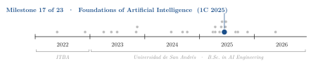
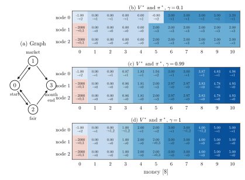
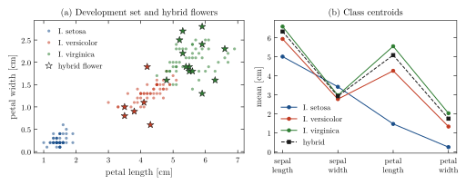
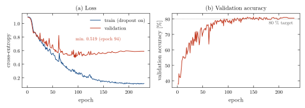
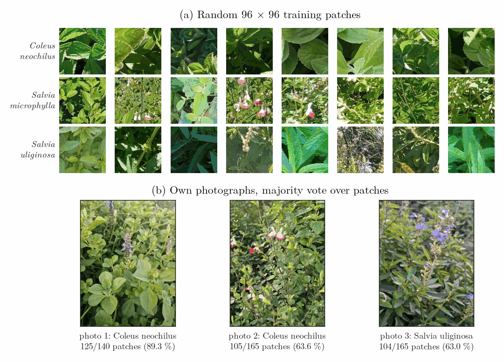
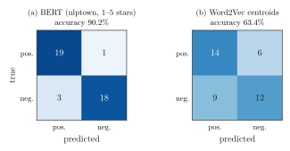

<div align="center">

# Native Plants: Value Iteration, k-NN, a Patch CNN and Sentiment Classification

**Santiago Groba Alonso**

Universidad de San Andrés · *Foundations of Artificial Intelligence* · First semester 2025 · Assignment 2

[](#reproducing-the-results)
[](#reproducing-the-results)

<picture>
  <source media="(prefers-color-scheme: dark)" srcset="docs/figures/trajectory-dark.svg">
  
</picture>

</div>

> **Abstract.** The second assignment of the course poses four short problems around a nursery of native plants, one per area of the course, each solved in its own notebook. (1) A month in the nursery is modelled as a Markov decision process over (location, money) and solved with value iteration for three discount factors; a short-sighted agent ($\gamma = 0.1$) ends the month as soon as it can pay the rent, while $\gamma = 0.99$ keeps buying plants first. (2) On Iris, three model families tuned by 3-fold cross-validation all reach about 97 %; the k-nearest-neighbours classifier used for the predictions (98.0 %) places a "secret" hybrid flower between *I. versicolor* and *I. virginica*. (3) A three-block CNN trained on 2,712 image patches of three native species reaches 80.5 % validation accuracy, the level the assignment asked for, and a majority vote over patches identifies two of the three photographs taken on campus for the assignment. (4) On 41 Spanish customer reviews of the nursery, a multilingual BERT sentiment model is right 90.2 % of the time, against 63.4 % for a Word2Vec nearest-centroid baseline.

---

## 1. Problem

The four parts of the assignment, delivered as notebooks in `notebooks/`:

1. **Reinforcement learning, "my nursery and I".** The state is the location on a four-node graph and the money held (0 to 10). The agent starts at node 0 with 2 to 8 pesos. Node 1 is a market (buy 3 plants for 5 pesos, reward $+3$), node 2 a fair (sell a plant for 1 peso, reward $-1$), node 3 the end of the month (reward $+2$ if the agent has more than 4 pesos for the rent, $-2000$ otherwise); running out of money also costs $-2000$. Find the optimal policy with value iteration (tolerance 0.1), print value and policy tables, and discuss $\gamma \in \{0.1, 0.99, 1\}$.
2. **Machine learning, "the secret flower".** Tune a supervised classifier on Iris with 3-fold cross-validation, predict the species of 19 measurements of a hybrid flower and compare class centroids.
3. **Computer vision, "plantifier".** Train the suggested CNN on 96×96 patches of *Coleus neochilus*, *Salvia microphylla* and *Salvia uliginosa* (80/20 split, about 80 % accuracy expected), show right and wrong patches, and classify three own photographs of these species taken in the Sullair building.
4. **NLP, "NLPlants".** Classify reviews as positive or negative with a pretrained BERT sentiment model and with Word2Vec embeddings plus nearest centroid, and compare.

## 2. Methods

| Part | Component | Choice |
|---|---|---|
| 1 | Environment | Deterministic transition table built from `step(state, action)` for all 44 states |
| 1 | Solver | In-place value iteration, stopping when $\max_s \lvert\Delta V(s)\rvert < 0.1$; greedy policy with ties kept |
| 2 | Model search | `GridSearchCV` (3 folds) over k-NN (with standardization), decision tree and random forest |
| 2 | Final model | k-NN, $k = 5$, uniform weights, on the four raw features |
| 3 | Network | Conv(16)–Pool–Conv(32)–Pool–Conv(64)–Pool–Dropout(0.5)–FC(64)–Dropout(0.5)–FC(3), ReLU, 3×3 kernels |
| 3 | Training | AdamW (lr $10^{-3}$, weight decay $10^{-4}$), one-cycle cosine schedule, batch 1024, 230 epochs, inputs scaled to $[-1, 1]$ |
| 3 | Own photographs | Cut into 96×96 patches with `patch.py` (stride 20), one prediction per patch, majority vote per photograph |
| 4 | BERT | `nlptown/bert-base-multilingual-uncased-sentiment`, 4–5 stars counted as positive |
| 4 | Word2Vec | `word2vec-google-news-300`, mean vector of in-vocabulary tokens, class with the higher cosine similarity to its training centroid |

## 3. Results

### 3.1 Value iteration

<p align="center"></p>

**Figure 1.** (a) Graph of the problem. (b–d) Optimal value $V^*$ (number, colour) and optimal next node (arrow) for every location and amount of money, obtained by re-running the notebook's value iteration. Red cells are states from which every action loses all the plants ($-2000$). Node 3 is terminal and omitted.

**Table 1.** Value of the starting states, $V^*(0, m)$, for the money range given in the statement.

| $\gamma$ | $m = 2$ | 3 | 4 | 5 | 6 | 7 | 8 |
|---|---:|---:|---:|---:|---:|---:|---:|
| 0.1 | 0.00 | 0.00 | 0.00 | $-0.80$ | 3.00 | 3.00 | 3.00 |
| 0.99 | 0.00 | 0.87 | 1.83 | 1.94 | 3.00 | 3.00 | 3.87 |
| 1 | 0.00 | 1.00 | 2.00 | 2.00 | 3.00 | 3.00 | 4.00 |

With $\gamma = 0.1$ the policy goes to the end of the month from the market or the fair as soon as it holds 5 pesos or more, because only the next reward matters. With $\gamma = 0.99$ and $\gamma = 1$ it returns to node 0 from the market or the fair whenever it has 6 pesos or more, to keep buying plants, and closes the month only with exactly 5 pesos (for $\gamma = 1$ this is a tie with returning). In every case, starting with exactly 5 pesos the first move is to the fair: buying would leave the agent with no money.

### 3.2 Iris and the hybrid flower

**Table 2.** Best 3-fold cross-validation accuracy of each model family (notebook output).

| Model | Best hyperparameters | CV accuracy |
|---|---|---:|
| k-NN (standardized) | $k = 9$, distance weights | 0.9733 |
| Decision tree | Gini, depth 3 | 0.9733 |
| Random forest | 50 trees, unlimited depth | 0.9667 |
| **k-NN used for the predictions** | $k = 5$, uniform weights, raw features | **0.9800** |

<p align="center"></p>

**Figure 2.** (a) Development set in the petal plane, with the 19 hybrid measurements (stars) coloured by the predicted species. (b) Mean of each feature per species and for the hybrid.

The notebook prints the prediction for the first hybrid measurement only (*I. virginica*). Applying the same model to all 19 rows, which `make_figures.py` does, gives 13 *I. virginica* and 6 *I. versicolor*. The centroid comparison of the notebook points the same way: the cosine similarity of the hybrid centroid is 0.9995 to *I. virginica*, 0.9981 to *I. versicolor* and 0.9019 to *I. setosa*, and in Figure 2b the hybrid lies between the two non-setosa species on every feature.

### 3.3 CNN on image patches

<p align="center"></p>

**Figure 3.** Learning curves parsed from the training log saved in `TP2-CV.ipynb` (2,169 training and 543 validation patches). The validation loss reaches its minimum, 0.519, at epoch 94 and then rises slowly to 0.590 while the training loss keeps falling; validation accuracy levels off at about 80 %.

**Table 3.** Accuracy of the trained network (notebook output).

| Set | Accuracy |
|---|---:|
| Training (2,169 patches) | 98.7 % |
| Validation (543 patches) | 80.5 % |

<p align="center"></p>

**Figure 4.** (a) Random training patches of each species. (b) The three photographs taken for the assignment and the majority vote of the CNN over their patches. Photographs 1 and 3 are classified correctly. The notebook reports photograph 2 as a misclassification and attributes it to two plants appearing in the same picture.

The notebook also shows the five most and least confident validation patches of each class; the least confident ones lack the cue the network relies on, either the flowers of the two salvias or a sharp, well-exposed leaf texture.

### 3.4 Sentiment of reviews

<p align="center"></p>

**Figure 5.** Confusion matrices on the 41 test reviews (20 positive, 21 negative), as saved in `TP2-NLP.ipynb`. BERT makes 4 mistakes; the Word2Vec centroid classifier labels 9 of the 21 negative reviews as positive.

## 4. Takeaways

- The discount factor changes the behaviour, not only the values: a short horizon collects the month-end reward right away, a long one keeps investing until the money is just enough for the rent.
- On Iris the three model families are separated by one flower out of 150 in cross-validation, so the choice among them matters less than the features: the two petal measurements alone isolate *I. setosa* and leave only a small overlap between the other two species (Figure 2a).
- The CNN overfits after roughly 100 epochs (Figure 3) without losing validation accuracy. A photograph is harder than a patch: it mixes several plants and much background, which a vote over patches can only partly absorb.
- A contextual model pays off on short reviews. The Word2Vec baseline averages context-free vectors, which loses negations, and the model used was trained on English news while the reviews are in Spanish.

## Reproducing the results

The notebooks were written and run inside the course repository (as `entregas/Groba/`), so their relative paths expect the course's dataset (`data/patches/`, `data/reseñas/`), the hidden test file `secret_flower.csv` and the helper `patch.py`. Those belong to the course and are not redistributed here; every notebook keeps its saved outputs, so the results can be read without re-running them. The CNN uses a GPU if one is available.

```bash
pip install numpy pandas matplotlib scikit-learn torch torchvision opencv-python tqdm
pip install transformers gensim "numpy<2"      # only for TP2-NLP.ipynb, as the assignment advises

python docs/figures/make_figures.py            # needs the course data listed above in data/ and notebooks/
```

| File | Content |
|---|---|
| `notebooks/TP2-RL.ipynb` | Part 1: environment, value iteration, tables for three discount factors |
| `notebooks/TP2-ML.ipynb`, `IRIS.csv` | Part 2: model search, hybrid prediction, centroids |
| `notebooks/TP2-CV.ipynb` | Part 3: CNN training, validation examples, photographs |
| `notebooks/mis_fotos/`, `notebooks/patches/` | The three photographs and the 470 patches cut from them |
| `notebooks/TP2-NLP.ipynb` | Part 4: BERT and Word2Vec sentiment classifiers |
| `docs/figures/` | Script and style used for the figures in this README |

## Acknowledgements

Assignment, datasets, the patch extraction script and the graph of Part 1 by the course staff of *Fundamentos de Inteligencia Artificial*, Gabriel Torre and Tomás Ravel.

## Citation

```bibtex
@misc{groba2025nativeplants,
  author       = {Groba Alonso, Santiago},
  title        = {Native Plants: Value Iteration, k-NN, a Patch CNN and Sentiment Classification},
  year         = {2025},
  howpublished = {Universidad de San Andr{\'e}s, Foundations of Artificial Intelligence},
  url          = {https://github.com/Santi2065/native-plants-ai}
}
```
